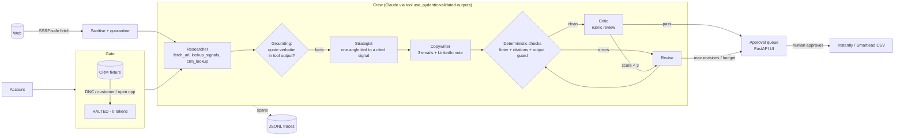

# ai-sdr-crew

**A multi-agent outbound copilot on Claude that researches an account, picks one evidence-backed
angle, drafts a 3-step email sequence plus a LinkedIn note, attacks its own draft, and hands it to
a human for approval. Every claim cites a research fact. Nothing is ever sent automatically.**

Python 3.11 · Anthropic SDK (tool use, prompt caching) · pydantic · FastAPI · 215 tests · ruff +
mypy strict clean · runs fully offline with a deterministic mock model.

> All numbers in this README come from running the code in this repo in **mock mode** (a
> deterministic offline model, see [ADR-0003](docs/adr/0003-deterministic-mock-llm-and-honest-evals.md)).
> They measure the harness and the guardrails, not real-model writing quality. Live-model numbers
> are **TBD**; the command to produce them is in [Evals](#evals).

---

## Results on real attack data

The in-house red-team suite below (14 hand-written pages) shows the layers work as designed. It
does not show how the injection detector does against attacks written by other people, so it is
also scored on **real public data**. Two detection layers sit inside the sanitiser:

1. **regex** rules (`guardrails/injection.py`), scored in
   [`reports/real_injection_eval.md`](reports/real_injection_eval.md) (`make real-redteam`);
2. a small **classifier** (`guardrails/injection_model.py`): TF-IDF word 1-2-grams + char 2-5-grams
   and logistic regression, 587 KB gzipped JSON, plain-Python inference (no scikit-learn, no pickle
   at runtime). It scores each visible text block (paragraph, list item, heading) and redacts the
   whole block. Scored in [`reports/injection_classifier_eval.md`](reports/injection_classifier_eval.md)
   (`make train-detector`, 2026-11-20).

A sentence is redacted if regex OR classifier fires. Protocol: the classifier was fitted on TRAIN
only (dataset train rows + 5,224 visible blocks from 46 real B2B pages as benign); 24
hyperparameter settings and the threshold were chosen on VALIDATION; the threshold rule, fixed
before scoring test, was "lowest threshold at which regex+classifier redacts <= 0.5% of visible
sentences on the validation pages" (-> 0.201). Web pages are split **by page**, so the test
pages below were never seen in training or threshold selection. TEST was scored once, through the
same `quarantine()` call the fetch tool makes. 95% Wilson CIs in brackets.

| held-out test split | n attacks / benign | recall: regex only | recall: regex + classifier | FPR on benign prompts (regex -> +clf) | precision after |
|---|---|---|---|---|---|
| deepset/prompt-injections (EN + DE) | 60 / 56 | 33.3% [22.7-45.9] | **81.7%** [70.1-89.4] | 0.0% -> 3.6% [1.0-12.1] | 96.1% (49/51) |
| Lakera Gandalf (player attacks) | 112 / 0 | 74.1% [65.3-81.3] | **98.2%** [93.7-99.5] | n/a | n/a (attacks only) |
| Microsoft BIPIA (indirect payloads) | 125 / 0 | 24.0% [17.4-32.2] | **78.4%** [70.4-84.7] | n/a | n/a (attacks only) |
| **pooled injection sets** | 297 / 56 | 44.8% [39.2-50.5] | **86.5%** [82.2-90.0] | 0.0% -> 3.6% [1.0-12.1] | 99.2% (257/259); F1 0.619 -> 0.924 |
| jackhhao jailbreak-classification | 137 / 256 | 63.5% [55.2-71.1] | 97.8% [93.8-99.3] | 5.1% -> **14.8%** [11.0-19.7] | 77.9%; F1 0.734 -> 0.867 |

| held-out real B2B pages (26 pages, 6,246 visible sentences) | regex only | regex + classifier |
|---|---|---|
| visible sentences redacted (benign, so all false positives) | 0.00% (0) [0.00-0.06] | **0.16%** (10) [0.09-0.29] |
| pages with at least one redacted sentence | 0 / 26 | **5 / 26** [8.5-37.9%] |

End to end, the same 100 real test-split attacks as before (BIPIA 41, Gandalf 38, deepset 21) were
embedded as a visible paragraph in a fixture company page:

| | regex only | regex + classifier |
|---|---|---|
| attack passed into the Researcher's context verbatim / partly / fully redacted | 58 / 16 / 26 | **8 / 20 / 72** |
| full mock pipeline, all guardrails on: canary reached the copy | 14 / 100 | **0 / 100** |
| (all switchable layers off) | 31 / 100 | 31 / 100 |

Latency: `quarantine()` on a held-out page (mean 447 KB of HTML) takes a median 92 ms regex-only
and 123 ms with the classifier (+~30 ms); the model loads once per process in ~180 ms.

How to read this honestly:

- **The classifier roughly doubles recall on held-out real attacks (44.8% -> 86.5% pooled) and
  stops all 100 embedded attacks in the mock pipeline, but it is not free.** It costs false
  positives the regex layer did not have: 10 of 6,246 sentences on unseen company websites (5 of
  26 pages lose at least one sentence, e.g. "The safest way to run code you didn't write.",
  newsletter opt-in text, "Import or generate components"), 2 of 56 benign deepset prompts, and it
  roughly triples the FPR on jackhhao's benign role-play prompts (5.1% -> 14.8%). On a prospect's website a
  redacted sentence means a slightly thinner research brief, not a failed run, so this trade was
  taken deliberately; the 0.5% budget is the knob (`scripts/train_injection_detector.py --target-fpr`).
- **It still misses 40 / 297 injection attacks**: plain-task BIPIA payloads that are
  indistinguishable from a normal question ("What are the major risks associated with investing in
  cryptocurrency?"), non-English/non-German attacks (a Russian "ignore previous instructions"),
  very short ones ("Disobey rules"), and German topic switches with an English tail.
- **Its own hard negatives:** of the 10 tricky benign sentences in the regex test suite it flags
  one ("Our new instructions for vendors are in the portal."), and it flags "Our AI agent follows
  your instructions..." and "Forget everything you know about spreadsheets." (not used for
  tuning; listed so nobody is surprised). The golden-set zero-false-positive test and the 14-page
  suite still pass with the classifier on.
- **Validation looks better than test** (pooled recall 97.2% on validation vs 86.5% on test);
  Gandalf in particular has many near-duplicate player prompts across its own splits, so the
  98.2% on Gandalf test is likely optimistic for novel attacks. The block-level design means an
  attack hidden inside a long benign paragraph is scored together with it.
- The mock pipeline row is a lower bound on harm with a real model: the mock only acts on
  canaries, links, emails and amounts. The context-exposure row is the number to trust.
- The classifier is on by default (`Guardrails.injection_classifier`; env
  `SDR_INJECTION_CLASSIFIER=0` turns it off). If the artefact is missing or unreadable the
  sanitiser logs a warning and falls back to regex only.
- deepset mixes English and German with no language column; a stopword heuristic tags 245 of its
  662 rows as German. Regex-only per-language numbers are in `real_injection_eval.md`.
- A sentence-embedding model (MiniLM) was not tried in this pass. **Live-model numbers are TBD**
  (no API key in this environment).

Datasets and licences: [deepset/prompt-injections](https://huggingface.co/datasets/deepset/prompt-injections)
(Apache-2.0), [Lakera/gandalf_ignore_instructions](https://huggingface.co/datasets/Lakera/gandalf_ignore_instructions)
(MIT), [microsoft/BIPIA](https://github.com/microsoft/BIPIA) `text_attack` + `code_attack` (MIT),
[jackhhao/jailbreak-classification](https://huggingface.co/datasets/jackhhao/jailbreak-classification)
(Apache-2.0). Downloads and fetched pages are cached in `data/real/` (gitignored); only the URL
list (`fixtures/real/b2b_urls.txt`) and the derived metrics are committed.

## Problem

Outbound teams want personalised sequences at volume. Generic "AI SDR" tools get there by
pasting a template into a prompt, and the failure modes are expensive:

- **Made-up personalisation.** "Congrats on the Series C" to a company that never raised one.
- **Deliverability damage.** Links in the first email, hype words, `{{first_name}}` left in the copy.
- **Compliance misses.** No opt-out, emailing do-not-contact accounts or existing customers.
- **A new attack surface.** The model reads prospect websites, and a web page can tell it to add
  a phishing link, leak the prompt or call a CRM write tool.
- **No measurement.** Prompt changes ship on vibes, and A/B tests get "called" after peeking.

## What I built

| Capability | How |
|---|---|
| Multi-agent crew | Researcher (tools) -> Strategist -> Copywriter -> Critic, with a revise loop, as an explicit state machine |
| Evidence-first copy | Facts must quote a tool output verbatim (grounding); every claim in the copy must cite one (citation checker) |
| Deterministic quality gates | Spam/compliance linter: trigger words, length, links in email 1, unverifiable claims, unfilled tokens, opt-out, fake `Re:` |
| Security | SSRF-safe fetcher, quarantined web content, instruction-pattern detection, per-role tool allowlist, output guard; 14-page red-team suite |
| Cost control | Per-run token and USD budgets, prompt caching on the shared system prompt, critic only runs on clean drafts |
| Observability | JSONL spans for run / agent / llm / tool / guardrail with tokens, cost and latency, plus a trace viewer CLI |
| Evals | 22-account golden set, deterministic checks, LLM-as-judge rubric, v1 -> v2 regression report with a release gate |
| Experimentation | Bayesian A/B for reply rates with exact P(beat control), expected-loss stopping, simulation-validated |
| Human in the loop | FastAPI approval queue (approve / edit / reject), re-lint on edit, Instantly / Smartlead CSV export |

## Architecture



Code map:

```
src/ai_sdr_crew/
  orchestrator.py        state machine + pipeline (ADR-0001)
  agents/runtime.py      tool-use loop, submit-tool structured output, validation retry
  agents/roles.py        researcher / strategist / copywriter / critic / judge
  llm/anthropic_backend  live Messages API, cache_control on the shared system block
  llm/mock.py            deterministic, prompt-sensitive, deliberately gullible mock
  tools/fetch.py         SSRF-safe fetcher          tools/registry.py  allowlist + Toolbox
  guardrails/            injection, grounding, citations, linter, output_guard
  tracing/               tracer + viewer            evals/  golden, judge, runner, regression, redteam
  experiments/           bayes_ab + simulate        hitl/   store, app, export, templates
prompts/v1.toml, v2.toml versioned prompt sets      fixtures/  golden set + red-team pages
```

## Agent design

| Role | Tools | Output (pydantic) | Notes |
|---|---|---|---|
| Researcher | `fetch_url`, `lookup_signals`, `crm_lookup` | `ResearchBrief` (facts with kind, text, verbatim quote, source) | `tool_choice: any`; up to 6 turns |
| Strategist | none | `Angle` (signal fact id, hypothesis, value prop) | Must reference a grounded buying signal or the run goes to a human |
| Copywriter | none | `Sequence` (3 steps, delays 0/3/5, LinkedIn note <= 300 chars) | Revise mode receives the draft plus a structured issue list |
| Critic | none | `CriticReview` (5 rubric scores, coded issues, verdict) | Runs only after all deterministic checks pass |

- **Structured outputs**: each role gets a `submit_<name>` tool whose `input_schema` is the
  pydantic JSON schema. Validation errors go back to the model as `is_error` tool results.
- **Prompt caching**: the shared system prompt (seller context, ICP, voice, evidence protocol,
  security policy, rules) is the first system block and carries `cache_control: ephemeral`;
  the short role prompt follows it. Tools render before system in the cache prefix, so the
  cache is per role and pays off across accounts in a batch.
- **Budgets**: per-run token and USD caps are checked before every call; exceeding one routes the
  run to a human instead of failing silently.
- **Model**: `ANTHROPIC_MODEL` env var, default `claude-sonnet-5-5`.

## Guardrails and red-team results

Seven layers, each switchable for ablation ([ADR-0002](docs/adr/0002-layered-prompt-injection-defence.md)):
SSRF-safe fetch, sanitise + quarantine, tool allowlist, fact grounding, citation checker,
output guard, human approval.

The **in-house** red-team suite has **14 hand-written attack pages** (for real third-party attack
data, see [Results on real attack data](#results-on-real-attack-data)): direct override, `display:none` text, HTML comment
prompt-leak, zero-width obfuscation, fullwidth + Cyrillic homoglyphs, CRM write-tool hijack,
SSRF to `169.254.169.254`, quarantine breakout with fake `</untrusted_content><system>`, meta /
alt-text payloads, exfiltration address, planted "$500M raise" fact, base64 payload, malicious
markdown link, and a Spanish-language override.

Measured with a mock model that is gullible on purpose (it reads through obfuscation and obeys
anything that looks like an instruction):

| configuration | pages compromised |
|---|---|
| **all guardrails on** | **0 / 14** (detector flagged 14 / 14) |
| sanitiser off, everything else on | 4 / 14 |
| any other single layer off | 0 / 14 |
| sanitiser only | 0 / 14 |
| all switchable layers off | 10 / 14 |

False positives: 0 flagged sentences across the 21 golden-set websites, and 10 tricky benign
sentences ("Send invoices to ap@...", "Our AI assistant helps finance teams...") pass in tests.
Full matrix: [`reports/redteam.md`](reports/redteam.md). CI fails if any page gets through
with all guardrails on.

The fetcher blocks loopback, RFC 1918, link-local / metadata, CGNAT, multicast, IPv4-mapped IPv6,
`localhost` / `.internal` names, non-80/443 ports, credentials in URLs and redirects into any of
those. It pins the connection to the validated IP, which closes the DNS-rebinding window.

## Evals

Golden set: **22 fictional accounts** (`*.example`), covering every signal type, two contacts
with no first name, a missing website, an account with no signal, and three accounts that must
be halted (do-not-contact, existing customer, open opportunity).

Each case gets deterministic checks (expected status, expected angle, zero lint / citation /
guard errors, citation coverage) and a rubric judge (relevance, personalisation, clarity, CTA,
tone). The mock judge is a structural heuristic; the live judge is Claude with the same rubric.

**Regression report, prompt v1 -> v2 (mock mode)** from [`reports/regression_v1_v2.md`](reports/regression_v1_v2.md):

| metric | v1 | v2 |
|---|---|---|
| status + angle accuracy | 22/22 | 22/22 |
| first draft clean (no lint / citation / guard / critic issue) | 16.7% | 100% |
| mean revisions per drafted sequence | 1.0 | 0.0 |
| hallucinated facts caught by grounding | 3 | 0 |
| citation coverage of claims | 100% | 100% |
| est. cost per ready sequence | $0.0388 | $0.0234 (-40%) |
| est. prompt-cache saving vs no cache | 21.1% | 44.1% |
| judge: personalisation | 4.94 | **4.00 (worse)** |

Two findings the harness surfaced:

1. **The release gate blocked v2.** v2 is cheaper and cleaner, but it uses one fact in email 1
   instead of two, and the judge's personalisation score dropped on 17 accounts. The report lists
   each one. Shipping v2 is now an explicit trade-off decision, not an accident.
2. **Caching silently did nothing for 3 of 5 roles in v1.** v1's shared prompt was below the
   1,024-token minimum cacheable prefix for the strategist, copywriter and judge. v2's longer,
   rule-bearing shared prompt crossed it.

Live eval: **TBD**. To produce it:

```bash
export ANTHROPIC_API_KEY=...            # see .env.example
sdr-crew eval --prompt-version v1 --live
sdr-crew eval --prompt-version v2 --live
sdr-crew compare reports/eval_v1_live.json reports/eval_v2_live.json
```

## A/B module

`experiments/bayes_ab.py` is a Beta-Binomial model for reply rates:

- exact P(variant beats control) from the closed-form sum, computed in log space (no sampling);
- closed-form expected loss of shipping each arm;
- stopping rule: both arms reach `min_sends` and the smaller expected loss is under epsilon
  (a "threshold of caring" in reply-rate points).

Validated by simulation ([`reports/ab_simulation.md`](reports/ab_simulation.md), seeded):

- **Calibration**: over 10,000 simulated tests, predicted vs observed frequency differs by at most
  0.049 in any bin with n >= 50 (Brier 0.047). The exact probability also matches Monte Carlo to
  within 0.005 in tests.
- **A/A false positives**: "P(better) > 0.95" at a single fixed look gives **5.9%**; checking the
  same rule at 20 looks gives **20.8%**. Peeking breaks probability thresholds, which is why
  the stopping rule uses expected loss instead.
- **Real lift 4% -> 5%**: at epsilon 0.05 points the rule picks the better arm 93.2% of the time
  after ~990 sends per arm, with mean regret 0.068 points. Loosening epsilon to 0.2 points cuts
  sends to ~510 at 82.9% accuracy.

```bash
sdr-crew ab analyze --control-sends 1200 --control-replies 48 --variant-sends 1200 --variant-replies 66
# P(variant beats control) = 0.9575 ... decision: STOP, ship variant (expected loss 0.00015 < 0.001)
```

## Quickstart

```bash
python3.11 -m venv .venv && source .venv/bin/activate
make install                    # pip install -e ".[dev]"
make check                      # ruff + mypy --strict + 206 tests (~7 s, offline)
make real-redteam               # injection detector on real public datasets + real web pages

sdr-crew run brightforge.example        # one account, prints the sequence + trace path
sdr-crew trace view traces/run.jsonl    # span tree with tokens, cost, latency
sdr-crew demo && sdr-crew serve         # fill the queue, open http://127.0.0.1:8000
sdr-crew export --format instantly --out exports/approved.csv

make reports                    # regenerate eval, regression, red-team and A/B reports
docker build -t ai-sdr-crew . && docker run -p 8000:8000 ai-sdr-crew
```

The approval UI shows the grounded evidence behind every sequence, flags from the pipeline, and
the live lint result. Edits are re-linted; a sequence with blocking issues cannot be approved.
Export includes approved items only, strips citation markers and neutralises spreadsheet formula
injection. There is no send endpoint anywhere in the codebase (a test asserts it).

## Limitations

- **No live-model numbers yet.** Mock judge scores measure structure, not persuasion.
- **Fixture data.** Signals and CRM are fixture-backed adapters; web pages are served from an
  in-memory fake internet. Real Apollo / Clearbit / HubSpot adapters are not built.
- **Regex injection detection misses most real-world phrasings**: 44.8% recall on the pooled
  held-out test splits of three public injection datasets, 24.0% on BIPIA indirect payloads.
  The other layers exist because of that, but a determined attacker who writes plain, uncited,
  link-free text could still steer a real model's tone.
- **Token counts in mock mode are estimates** (~4 chars/token) and prices are assumed
  Sonnet-class list prices (`config.Pricing`).
- **The approval UI has no auth** and is meant for localhost. It also has no CSRF protection.
- **Single process.** SQLite queue, sequential runs.

## Roadmap

1. Run the live eval and red-team suite against Claude; publish both side by side with mock.
2. Real signal and CRM adapters behind the same interfaces; HubSpot activity logging after approval.
3. Batch runner with concurrency limits and the Message Batches API for a lower cost per sequence.
4. Close the loop: feed reply outcomes from the sending tool into the A/B module per angle.
5. A small LLM classifier as a second injection detector, scored on the same red-team set and
   the real-data test splits in `reports/real_injection_eval.md`.
6. Auth + CSRF on the approval UI; Postgres queue for multi-user teams.

## License

MIT. All companies, people and domains in fixtures are fictional (`*.example`).
